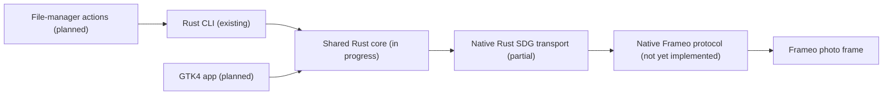

# Framebridge

Framebridge is an independent, open-source Linux project for sending photos to Frameo digital photo frames. The goal is a native Rust client with a command-line interface first, followed by a GTK4 desktop application and optional file-manager integration.

> **Development status (28 November 2026): native protocol work in progress; not yet a standalone photo-transfer client.** Framebridge has native Rust identity/configuration handling and several SecureDeviceGrid (SDG) cryptographic and wire-format primitives, but no complete native SDG connection, pairing or photo upload. The current CLI **still invokes the external `unframeo` executable** for operational commands. This is legacy code awaiting replacement, **not** the desired architecture. The old Flatpak build bundled that backend and has been disabled. There is currently **no verified, native-only working Flatpak**.

## What works today

The repository contains:

- A Rust command-line executable, currently named `frameo` (Cargo package `frameo-linux`).
- Local argument and file validation plus a **temporary external-process adapter** for `pair`, `upload`, `frames` and `discover`.
- Native Rust X25519 identity key generation and public-key derivation.
- Configuration read/write support compatible with the older `unframeo/config.json` format, including atomic writes and Unix owner-only permissions.
- SDG TCP length-prefix framing, packet headers, nonce layouts and authenticated encryption.
- NaCl-compatible shared-key precomputation, `crypto_secretbox` operations and an encrypted SDG `MESG` wire codec.
- Unit tests including deterministic cryptographic/reference vectors, and GitHub Actions checks for formatting, tests and Clippy.

**Important:** The native components are independently testable foundations, not yet a connected Frameo client. Passing cryptographic/unit tests does not establish compatibility with a physical photo frame.

## Native Rust implementation status

| Area | Current status |
| --- | --- |
| Rust workspace and CLI command definitions | Implemented |
| Identity and compatible configuration storage | Implemented |
| SDG packet framing, nonces, X25519 and NaCl primitives | Implemented, with tests |
| Shared-key encryption and `MESG` wire encoding/decoding | Implemented, with reference-vector tests |
| SDG handshake (HELO/COOK/VOCH/REDY), live session management | **Incomplete** |
| Pairing challenge/response in native Rust | **Not implemented** |
| Grid control, relay, and direct peer connections | **Not implemented** |
| Local mDNS discovery in native Rust | **Not implemented** |
| Frameo application protocol and actual photo transfer | **Not implemented** |
| Existing CLI `pair`, `upload`, `frames`, `discover` | **Still delegates to unframeo** |
| Native-only Flatpak | **Not available**; legacy build disabled |
| GTK4 application, upload queue, Nemo integration | Planned |

The final product **must not** rely on unframeo or Go, whether installed on the host or bundled inside Flatpak. The [unframeo repository](https://github.com/borje/unframeo) is used **only as a protocol-behavior reference**, with source provenance documented in [UPSTREAM_REFERENCE.md](docs/UPSTREAM_REFERENCE.md) and [NOTICE](NOTICE). The implementation target is native Rust, not a wrapper or a Go binary redistributed inside the application.

## Build and test the current Rust code

Install Rust 1.85 or newer, then:

```sh
git clone https://github.com/stiffes/frameo-linux.git
cd frameo-linux

cargo fmt --all -- --check
cargo test --all-targets
cargo clippy --all-targets -- -D warnings
cargo build --release
```

The current executable is `target/release/frameo`. It is useful for inspecting the CLI and developing the native library, but it **cannot pair or upload on its own**.

### Current CLI commands — legacy adapter only

```sh
frameo pair <pairing-code>
frameo frames
frameo discover
frameo upload photo.jpg another-photo.jpg
frameo upload --caption "Holiday" photo.jpg
```

These are existing commands, **not native Rust end-to-end features**. At present, running them requires a separately installed `unframeo` executable. Setting `FRAMEO_UNFRAMEO_BIN` selects its path. This adapter is scheduled for removal once native pairing and transfer are implemented. For the intended unframeo-free client, do **not** treat these commands as functional today.

## Flatpak status

The repository contains an **experimental historical Flatpak manifest and build script** under [packaging/flatpak](packaging/flatpak). That packaging bundles the unwanted Go-based backend, so **it is not the requested Framebridge release**.

The [Flatpak GitHub Actions workflow](.github/workflows/flatpak.yml) is explicitly **disabled** pending native transport support. No downloadable bundle should be described as an independently functioning native-Rust photo uploader until it has been built and tested. Packaging will be re-enabled after the actual native operations exist; real-device pairing/upload still need separate verification.

## Target architecture



The old unframeo process adapter remains only in the **current code**, outside this intended architecture. Both CLI and future GTK4 frontend should use the same native core. GTK and Nemo integration are optional; the CLI should continue to work independently of any desktop environment.

## Next milestones

1. Finish the SDG handshake, authenticate sessions and enforce counters/replay protection.
2. Implement native pairing and safe persistence of peer identities.
3. Implement grid-control and relay connections as well as direct LAN transport and mDNS discovery.
4. Implement Frameo application messages and end-to-end photo upload.
5. Switch CLI commands to the native library and **delete the unframeo process adapter**.
6. Rebuild the Flatpak without Go or unframeo, run integration/smoke tests and verify pairing/upload on real hardware.
7. Build the GTK4 frontend and optional Nemo integration on top of the shared core.

Detailed protocol boundaries and remaining test work are tracked in the [Rust porting plan](docs/PORTING_PLAN.md).

## Contributing

Contributions, reproducible test fixtures and issue reports are welcome. Please include your Linux distribution, device model and sanitized diagnostic output. **Never post private pairing keys, credentials or real-device secrets.**

## Disclaimer

Frameo is a trademark of its respective owner. Framebridge is an independent community project, not affiliated with, endorsed by or supported by Frameo.

## License

GPL-3.0-or-later. See [LICENSE](LICENSE) and [NOTICE](NOTICE).
