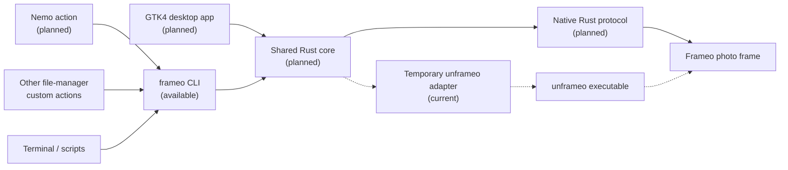

# Frameo Linux

Frameo Linux is an open-source Linux client for sending photos to Frameo digital photo frames. It is being built as a desktop-independent CLI with an optional GTK4 application planned.

The CLI is the first working interface. It does not require GTK or a running desktop session, so it can also be called from shell scripts and file-manager custom actions.

> **Status: early development.** The current CLI uses the existing [unframeo](https://github.com/borje/unframeo) executable as a temporary protocol backend. The project direction is a native Rust implementation; `unframeo` will be a development reference, not a runtime dependency. See the [native Rust protocol porting plan](docs/PORTING_PLAN.md). GTK and Nemo integration are not implemented yet. Experimental [Flatpak packaging](packaging/flatpak/README.md) is available for the CLI.

## Current CLI

The current CLI supports pairing, photo uploads, listing paired frames and local network discovery by invoking the `unframeo` backend.

```bash
# Pair with the code displayed on the frame
frameo pair 12345678

# Upload one or more photos
frameo upload photo.jpg another-photo.jpg

# Upload photos with a caption
frameo upload --caption "Holiday 2026" ~/Pictures/*.jpg

# List paired frames and discover frames on the LAN
frameo frames
frameo discover
```

The commands above are implemented in this project, but the current transitional adapter requires the separate `unframeo` executable. The CLI validates local photo paths and delegates pairing and transfer to that backend. This dependency is temporary and will be removed as the native Rust protocol implementation is completed.

## Install

The current transitional CLI requires the unframeo backend. This installation step will disappear once the native Rust backend is implemented.

### 1. Install the temporary unframeo backend

The upstream project currently requires Go 1.26.0 or newer:

```bash
go install github.com/borje/unframeo/cmd/unframeo@latest
```

Make sure `$(go env GOPATH)/bin` is in your `PATH`.

See the [unframeo project](https://github.com/borje/unframeo) for protocol details, configuration and security notes. Pairing creates a private identity key; protect and back up its configuration securely.

### 2. Build Frameo Linux

Install Rust using [rustup](https://rustup.rs/), then:

```bash
git clone https://github.com/stiffes/frameo-linux.git
cd frameo-linux
cargo build --release
```

The executable is created at `target/release/frameo`. To install it into Cargo's user binary directory:

```bash
cargo install --path .
```

If the backend executable is not named `unframeo` or is not in `PATH`, set its path explicitly:

```bash
export FRAMEO_UNFRAMEO_BIN=/path/to/unframeo
```

### 3. Flatpak development bundle

See the [Flatpak build and installation instructions](packaging/flatpak/README.md). The experimental bundle includes the temporary backend and is built by the [Flatpak workflow](https://github.com/stiffes/frameo-linux/actions/workflows/flatpak.yml).

## Interfaces and desktop support

### CLI

The CLI has no GTK dependency and is intended to work across Linux distributions, including headless systems. It can be called from a terminal, scripts, Nemo actions or custom actions in other file managers.

### GTK desktop application

A GTK4 desktop application is planned, using the same application core as the CLI. It is intended for GTK4-capable Linux desktops such as GNOME and Cinnamon; compatibility with other environments will be tested. The application is not limited to Linux Mint or Nemo.

### File-manager integration

File-manager integration is optional:

- **Nemo:** a dedicated right-click action is planned.
- **Other file managers:** use their custom-action facility to invoke `frameo upload` with selected file paths.
- **Flatpak:** host-side file-manager integration will require a portal-aware mechanism; it is not part of the current CLI.

## Architecture



The native Rust protocol will be shared by the CLI and GTK application. The current process adapter is only a bridge while the protocol is being ported; it is not the intended final architecture.

## Development

```bash
cargo fmt --all -- --check
cargo test --all-targets
cargo clippy --all-targets -- -D warnings
```

GitHub Actions runs these checks on pushes to `main` and pull requests.

## Development status

| Component | Status |
| --- | --- |
| Rust project and CLI | Implemented |
| unframeo process adapter | Implemented |
| Pairing and photo upload | Delegated to unframeo |
| CLI unit tests and CI | Added |
| Native Rust protocol foundation | Identity/config, SDG framing, nonces and NaCl box primitive added; transport not complete |
| GTK4 application | Planned |
| Shared GUI/CLI upload queue | Planned |
| Nemo context-menu action | Planned |
| Generic file-manager integration | CLI can already be called |
| Flatpak packaging | Experimental CLI build and CI workflow; device testing pending |

## Contributing

Issues and contributions are welcome. Include your Linux distribution/version, Frameo device model and relevant logs when reporting a problem. Never include pairing keys, credentials or other private configuration in bug reports.

## Disclaimer

Frameo is a trademark of its respective owner. This is an independent community project and is not affiliated with, endorsed by or supported by Frameo.

## License

Frameo Linux is licensed under the GNU General Public License, version 3 or (at your option) any later version. See [LICENSE](LICENSE).
